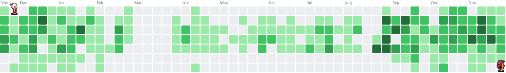

# Hi, I'm Jeffrey 👋

Developer at [MintyMedia](https://mintymedia.nl). I build dashboards in Next.js and the APIs behind them.

Also: shadcn/ui · TanStack Query & Table · React Hook Form + Zod · Hono · Playwright · Storybook

  

---

<picture>
  <source media="(prefers-color-scheme: dark)" srcset="https://raw.githubusercontent.com/JeffreyvdZ/JeffreyvdZ/output/bomberman-contribution-graph-dark.svg">
  <source media="(prefers-color-scheme: light)" srcset="https://raw.githubusercontent.com/JeffreyvdZ/JeffreyvdZ/output/bomberman-contribution-graph.svg">
  
</picture>

